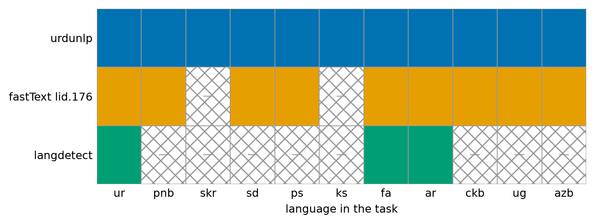
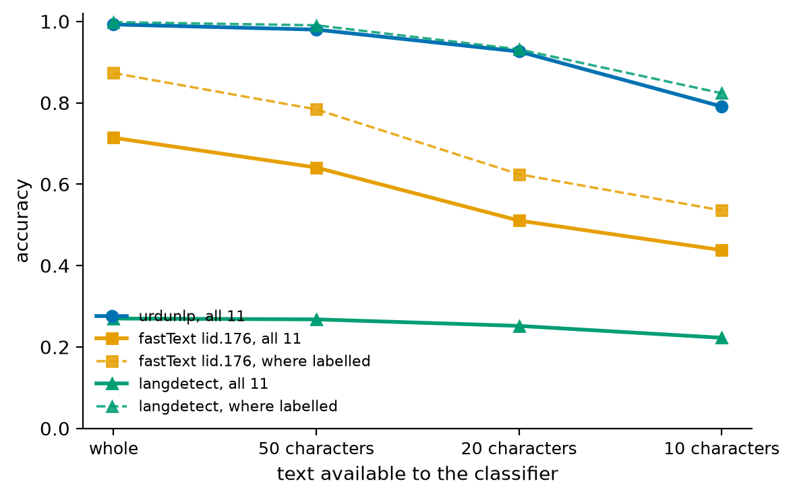
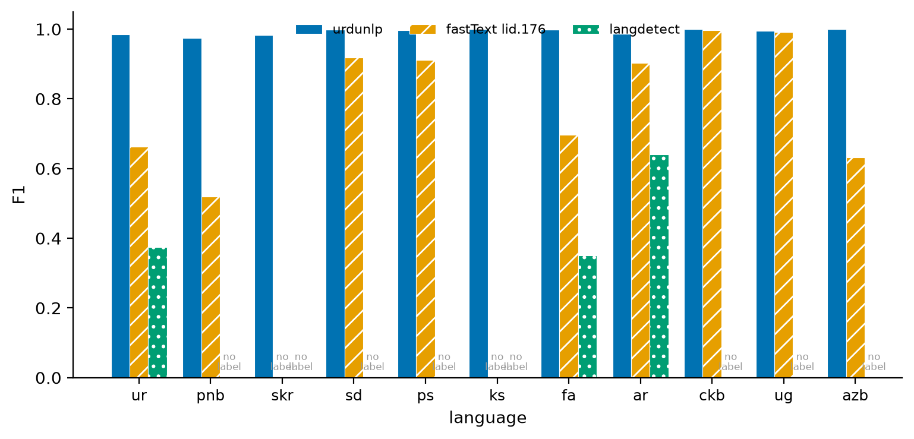
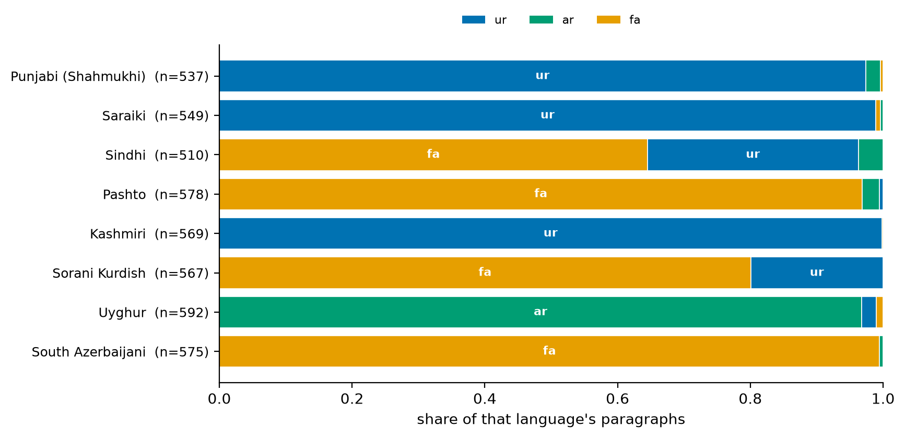
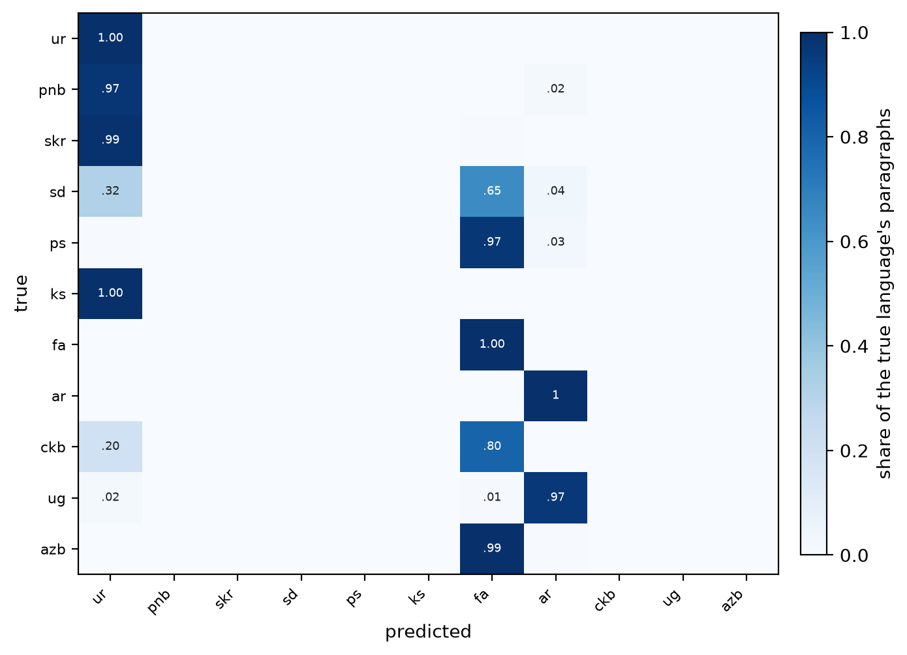
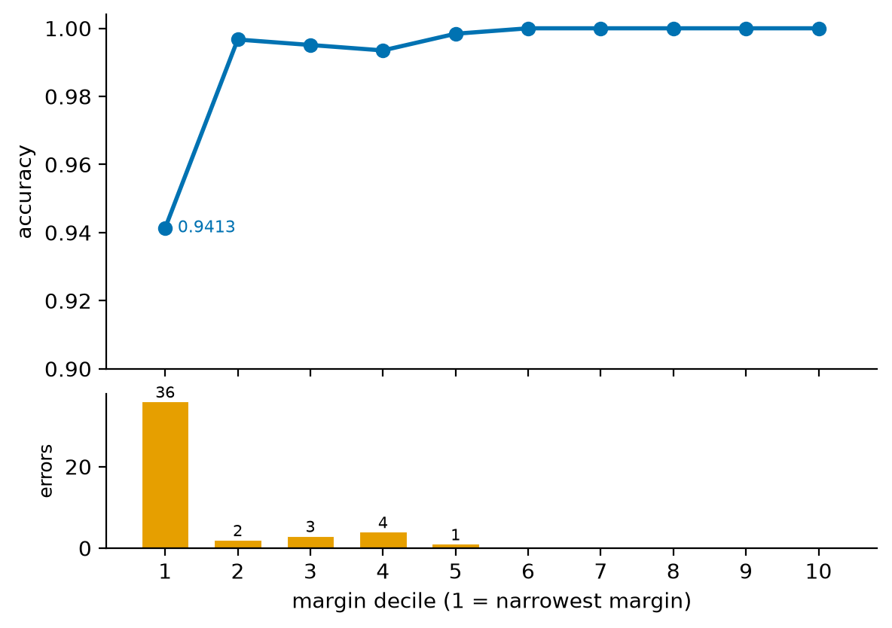
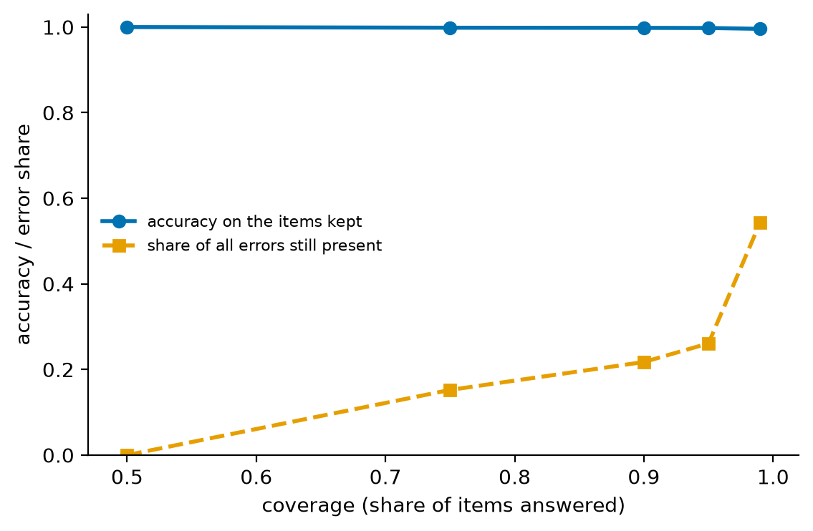

# Abstract

Language identification is treated as a solved problem, and for the languages that
benchmark it, it is. It is not solved for the Perso-Arabic script. Eleven languages share
it — Urdu, Shahmukhi Punjabi, Saraiki, Sindhi, Pashto, Kashmiri, Persian, Arabic, Sorani
Kurdish, Uyghur and South Azerbaijani — and the two detectors a project reaches for first
cannot name all of them: `langdetect` has a label for **3 of the 11**, fastText's
`lid.176` for **9**, missing Saraiki and Kashmiri, two of the three languages Urdu is most
confusable with. Coverage, not accuracy, is the first result: a detector with no label for
Saraiki cannot be right about Saraiki, and scoring it wrong says little.

Against a dedicated competitor — PALI [@pali], a fastText model trained for exactly this
script — a character n-gram classifier trained on Wikipedia reaches **0.9925** against
PALI's **0.8088** on 6,136 held-out paragraphs (McNemar, 1,136 vs 9 discordant,
p < 10⁻³²²). That test set is balanced, which is a choice and not a neutral one:
reweighting the **same predictions** to CC-100's language proportions, where Persian and
Arabic are 95% of the text, takes langdetect from the worst system to **0.9816** and PALI
from the best competitor to **0.4598** (§4.6). The order of the competitors is a property
of the test set.

That 0.9925 is the paper's second result, and it is a warning rather than an
achievement. On out-of-domain text the same model collapses: **0.5302** on Tatoeba Urdu
and **0.2565** on Quran-translation Urdu, with roughly three quarters of Urdu sentences
labelled Shahmukhi Punjabi. Two independent sources agree, so this is the model and not
label noise. No number available in the single-domain setup could have warned of it,
because training and test came from one domain.

Rebuilding the corpus from every real source these languages have — **3,587,017 lines
over 36 source–language pairs**, drawn from CC-100, eight OPUS corpora and two Wikimedia
projects, with every source contributing to train, validation and test — raises Urdu from
**0.5400 to 0.9900** on 36,000 held-out rows, and the overall figure from **0.9231 to
0.9780** over 358,720 rows.

Where real text ran out we built it. Kashmiri has 19,256 usable lines in existence and no
non-Wikimedia source anywhere, so 254,732 further lines were generated by resampling its
own attested vocabulary. Scored against a control differing in exactly one thing, on
identical real held-out rows, **the built data did not help and at short inputs it hurt**:
−0.0183 accuracy at a 10-character window (p = 10⁻¹⁵) and −0.0126 at 20 (p = 10⁻¹⁴),
against a null on whole paragraphs that would have read as harmless had we stopped there.
We report the negative result against a criterion fixed before the run, and the model we
would ship is the one trained without the built rows. The contribution is therefore less a better classifier than
a demonstration that **single-domain evaluation of low-resource language ID is capable of
reporting 0.99 for a model that is wrong three times in four**, and a corpus and protocol
that make the failure visible.

# 1. Introduction

The Perso-Arabic script is shared by languages from three unrelated families. Urdu and
Shahmukhi Punjabi are mutually intelligible in writing to a degree that defeats
word-level heuristics; Saraiki is classified by some as a Punjabi dialect and writes with
four additional implosive letters that appear only sometimes; Kashmiri's Perso-Arabic
orthography competes with a Devanagari one, so even corpus collection has to check which
script a "Kashmiri" file is in.

General-purpose detectors address this by not addressing it. The gap is not that they are
inaccurate on these languages — it is that most of these languages are **not in their
label sets at all**, which is a different and more consequential problem, because a
missing label produces a confident wrong answer rather than an abstention.

A dedicated model exists. PALI [@pali] is a fastText classifier over nineteen
Perso-Arabic language labels, and it is the right comparator: it covers the task. This
paper measures against it and against the two general-purpose detectors, and then turns
the same instruments on its own result and finds it wanting.

**Prior work on the domain problem.** The general phenomenon in §5 is known and we do not
claim it. ConLID [@conlid] argues that cross-entropy-trained LID learns a domain's style
rather than a language's identity, which bites hardest for low-resource languages whose
training data comes from a single source, and reports gains out of domain from contrastive
training. DIVERS-Bench [@divers] evaluates LID across domains and finds systems — fastText
`lid.176` among them, itself largely Wikipedia-trained — failing to generalise out of
domain and in low-resource settings. An earlier draft of this paper claimed no such study
existed. It was wrong, as a comparable absence-based claim in a sibling project was also
wrong, and the two together are a reason to distrust the form of argument rather than
just to patch the sentence.

What is specific here is the instance and its mechanism: *which* languages collapse into
*which* others, measured on a script where the label sets of general-purpose detectors do
not even cover the task. The failure is not diffuse degradation but a single dominant
confusion — three quarters of out-of-domain Urdu labelled Shahmukhi Punjabi — and §6 shows
that rebuilding the corpus repairs it, at a cost that falls precisely on the two languages
with no second source to add. That cost is the part a general result cannot give, because
it is a property of what exists for these languages and not of the method.

# 2. Method

## 2.1 The task and the label set

Eleven languages, chosen because they are the ones Urdu is **actually** confused with
rather than a convenient set. All eleven are written in Perso-Arabic. Telling Urdu from
English is not the problem; telling it from Saraiki is.

The classifier is a character n-gram model over script-aware features. Its details are
not the contribution and are in the repository; what matters for this paper is that it is
small, has no neural component, and is the kind of model a project would actually depend
on.

## 2.2 Evaluation protocol

Every comparison scores all systems **on the same rows in the same run**. Rates carry
Wilson 95% intervals, which stay inside [0, 1] where the normal approximation does not —
and several rates here sit at the boundary. Paired comparisons use **McNemar's exact
test** over discordant pairs, computed in log space with `lgamma`, because the two-sided
tail underflows to 0.0 for tables as lopsided as 1,136 against 9 and a published
`p = 0` would be a floating-point artefact rather than a result.

Where a system has no label for a language, two numbers are reported: accuracy over all
eleven languages, and accuracy restricted to the classes the system can name. Only the
second is a statement about the model; only the first is a statement about using it for
this task.

A rate is **withheld** where the sample cannot support one. Tatoeba's Sindhi is seven
sentences; a rate over seven has an interval wider than the range it lives in, so the
count is published and the rate is not. The decision is on whether the population
supports the question, never on a row count alone, and the reason is printed in the
output rather than left to the reader.

# 3. Coverage comes first

| | labels in the model | labels for this task | no label for |
|---|---:|---:|---|
| **this tool** | 11 | **11 of 11** | — |
| PALI | 19 | **11 of 11** | — |
| fastText `lid.176` | 176 | 9 of 11 | **Saraiki, Kashmiri** |
| `langdetect` | 55 | **3 of 11** | Punjabi, Saraiki, Sindhi, Pashto, Kashmiri, Sorani, Uyghur, South Azerbaijani |

This table decides how to read every number below it. `langdetect` can name three of
eleven; fastText covers nine and still misses Saraiki and Kashmiri.

**Figure 1.** Label coverage of the eleven-language task by system.

# 4. Accuracy, whole and truncated

On the test split of the Wikipedia corpus — 6,136 paragraphs over eleven languages —
whole and cut to 50, 20 and 10 characters:

| | whole | 50 chars | 20 chars | 10 chars |
|---|---:|---:|---:|---:|
| **this tool** | **0.9925** | **0.9798** | **0.9260** | **0.7909** |
| PALI, principled mapping | 0.8088 | 0.7238 | 0.5758 | — |
| PALI, generous mapping | 0.8955 | 0.8020 | 0.6333 | — |
| fastText, all 11 languages | 0.7140 | 0.6410 | 0.5106 | 0.4379 |
| fastText, where it has a label | 0.8731 | 0.7838 | 0.6244 | 0.5355 |
| `langdetect`, all 11 languages | 0.2699 | 0.2678 | 0.2518 | 0.2226 |
| `langdetect`, where it has a label | 0.9982 | 0.9904 | 0.9313 | 0.8234 |

Two rows of that table need explaining, and both are concessions.

**PALI is scored under two label mappings.** PALI's label set is not this one: it has
`ud` where this task has `ur`, `pa` for Shahmukhi Punjabi, `kas` for Kashmiri, and
separate `mzn` (Mazanderani) and `sdh` (Southern Kurdish) labels. A mapping is therefore
required, and the choice of mapping is worth 8.7 points to PALI. An earlier draft learned
the mapping by majority vote on the validation split, which assigned `fa → mzn` and
`ckb → sdh` — that is, it credited PALI's *errors* as naming differences and scored them
correct. The principled mapping uses **identity wherever PALI has our code** and derives
a mapping only where it does not; the generous mapping is the majority-vote one, reported
beside it so the reader can see the size of the concession rather than take the author's
word for which is fair.

**`langdetect`, restricted to its three labels, is not beaten.** It scores 0.9982 against
this tool's 0.9964 on those 1,659 rows, and McNemar gives **p = 0.375** over five
discordant pairs. That is a null result and it is reported as one. On Urdu, Persian and
Arabic — three well-resourced languages with ample training data — a 2010-era detector is
as good as this one. The claim of this paper is about the eight languages `langdetect`
cannot name, not about the three it can.

**Figure 2.** Accuracy against input length. Every system degrades; the ordering does not
change.

## 4.1 Per-language F1

| language | support | this tool | PALI | fastText | `langdetect` |
|---|---:|---:|---:|---:|---:|
| ur | 578 | **0.985** | 0.718 | 0.662 | 0.374 |
| pnb | 537 | **0.975** | 0.797 | 0.519 | no label |
| skr | 549 | **0.983** | 0.936 | no label | no label |
| sd | 510 | **0.999** | 0.983 | 0.919 | no label |
| ps | 578 | **0.997** | 0.987 | 0.912 | no label |
| ks | 569 | **1.000** | 0.993 | no label | no label |
| fa | 523 | **0.999** | 0.475 | 0.696 | 0.351 |
| ar | 558 | **0.986** | 0.957 | 0.903 | 0.641 |
| ckb | 567 | **1.000** | 0.400 | 0.997 | no label |
| ug | 592 | **0.994** | 0.987 | 0.991 | no label |
| azb | 575 | **1.000** | 0.971 | 0.632 | no label |

Precision is reported as undefined, not as 0.0, where a system never predicts a class:
`langdetect` has no Punjabi label, so its Punjabi precision is a quantity with no
denominator and printing 0.000 would invent one.

PALI's two low cells — Persian 0.475 and Sorani 0.400 — are the mapping problem made
visible. Under the generous mapping they rise sharply, which is why both mappings are
published.

**Figure 3.** Per-class F1 across the four systems; absent labels left blank rather than
plotted as zero.

## 4.2 Paired significance

| comparison | this tool only | other only | discordant | p |
|---|---:|---:|---:|---|
| vs PALI | 1,136 | 9 | 1,145 | < 10⁻³²² |
| vs fastText | 1,717 | 8 | 1,725 | < 10⁻⁴⁹⁷ |
| vs `langdetect` | 4,438 | 4 | 4,442 | < 10⁻¹³²³ |
| vs `langdetect`, its 3 labels only | 1 | 4 | 5 | **0.375** |

The last row is the honest one and is why the first three are reported with their
restricted counterparts rather than alone.

## 4.3 A confound stated rather than discovered

**Possible train/test overlap with PALI, which we cannot rule out or confirm.** This test
set is Wikipedia. PALI's repository ships its training corpora but does not document
where they came from; neither the paper's abstract nor the repository names Wikipedia as
a source. An earlier draft of this paper asserted that PALI trains on Wikipedia dumps.
That assertion had no source and has been withdrawn — what can be said is that PALI's
provenance is undocumented, so overlap with these paragraphs is possible and unverified.

The direction matters more than the fact. Any overlap would run **in PALI's favour**, so
this tool's lead over PALI is conservative under it, and a lead for PALI could not have
been read as clean. Nothing in §4 depends on the overlap existing.

A second caveat on PALI's labels, from its own repository: it documents `sdh` as Southern
Kurdish while the distributed model's label list treats it inconsistently. The mapping in
§4 therefore uses identity wherever PALI has our code and reports the alternative beside
it, rather than resolving an ambiguity in another project's label set by assertion.

## 4.4 What a missing label actually does

A system with no label for a language does not abstain — it answers something else,
confidently. That is why coverage is §3 and not a footnote.

**Figure 4.** What `langdetect` answers for the eight languages it has no label for, whole
paragraphs. **Kashmiri is labelled Urdu in 99.8% of its paragraphs.** Each bar sums to
one; segments are the answers the system actually gave. For a pipeline routing text by
detected language, this is not a missing answer but a wrong one at near-certainty.

**Figure 5.** Row-normalised confusion for `langdetect` over 6,136 paragraphs. Every
answer fell inside the task's eleven labels, so the errors are misattributions among
these languages rather than escapes to unrelated ones.

## 4.5 Knowing when to doubt the answer

**Figure 6.** Accuracy by margin decile, 6,136 items, 613–614 per decile. **36 of the 46
errors (78%) fall in the narrowest decile**, so the margin carries usable information
about which answers to doubt. The accuracy axis is truncated below 0.9 to make the spread
visible; the error panel is not truncated. An earlier version of this figure used three
bins, which put 6,131 of the 6,136 items in one of them and showed nothing.

**Figure 7.** Selective prediction: answer only the items whose margin is in the top
fraction. At 50% coverage, accuracy on the 3,068 items kept is 1.0000 and **none of the 46
errors remain**. The error share is plotted beside accuracy because accuracy on a
shrinking set rises whether or not abstention is choosing the right items to drop.

This is the practical consequence of §3 and §4 together: a model that covers the task can
also say when it is unsure, and a model that cannot name the language cannot do either.
These numbers are in-domain, and §5 is about what happens when that assumption fails.

## 4.6 The balanced test set is a choice, and it decides the ranking

Every accuracy above is over a test set with roughly equal numbers of each of the eleven
languages — about 550 paragraphs each. That is how language-identification benchmarks are
built and it is not how text arrives. An experience report on OpenLID-v3 makes the point
plainly: precision and F1 on standard LID datasets can mislead, because models meet a far
larger language imbalance in real crawls than in any benchmark. Persian and Arabic are not
two elevenths of Perso-Arabic text on the web, and Kashmiri and Saraiki are not one
eleventh each.

`research/prior_shift.py` recomputes the comparison under two other populations without
re-predicting anything. Per-class recall is held fixed and the class prior replaced, so
`W[t][p] = π(t)·C[t][p]/n_t` and every metric follows from `W`. That is the standard
prior-shift assumption — the distribution of text *within* a language does not change with
the prior — and it is assumed, not tested. The priors are **wikipedia** (article counts
per edition, all eleven have one) and **crawl** (CC-100 bytes, which covers six of the
eleven; azb, ckb, ks, pnb and skr are absent from CC-100 entirely and are given the
smallest observed share, an approximation that overstates their presence rather than
understating it). Under the crawl prior Persian and Arabic are 95% of the population
between them.

| system | uniform | wikipedia | crawl |
|---|---|---|---|
| **urdunlp (this work)** | 0.9925 / 0.9925 | 0.9986 / 0.9899 | 0.9995 / 0.9870 |
| PALI | 0.8069 / 0.9456 | 0.6954 / 0.7119 | 0.4598 / 0.5691 |
| fastText `lid.176` | 0.7145 / 0.8055 | 0.9398 / 0.9634 | 0.9937 / 0.9229 |
| langdetect | 0.2722 / 0.3102 | 0.8520 / 0.8057 | 0.9816 / 0.9296 |

*accuracy / macro precision, over the same 6,136 predictions in every cell.*

The uniform column is **not** the micro-accuracy quoted elsewhere in this paper. A prior
is a weight per class, so "uniform" is the unweighted mean of eleven per-class recalls,
while the headline figures are correct predictions over all 6,136 rows — and the test
set is only roughly balanced, 510 to 592 rows per language, so the two differ a little.
PALI reads 0.8069 here against 0.8088 in §5, and this toolkit 0.9925 in both. The column
is here as the baseline the other two are reweighted from, not as a restatement of the
headline.

**The ranking of the competitors is not a property of the models. It is a property of the
test set.** On the balanced set langdetect is the worst system by a wide margin
(0.2722) and PALI the best competitor (0.8069).
On the crawl population langdetect is 0.9816 and PALI is
0.4598 — the order reverses. Neither number is wrong and neither is the
model changing. langdetect supports three of these eleven languages and scores 0.000
recall on the other eight; when those three are 98% of the text, a three-language model is
a 0.98 model. PALI's recalls are 0.954 to 1.000 on seven of the eight rare languages — 0.865 on
Shahmukhi Punjabi — against 0.886 on Persian and 0.658 on Urdu, so a population
dominated by Persian and Arabic punishes it.

**What each prior is for.** The balanced set measures the part of the task that is hard —
telling Saraiki from Western Punjabi, Kashmiri from Urdu — and a system is only useful on
real text if it does not fall over on the 95%. The crawl prior measures deployment and
says nothing about whether a system can do the hard part at all: langdetect's
0.9816 is earned entirely by languages it was already good at. The
pair is the result. Reporting either alone chooses an answer.

**This toolkit is the only system above 0.98 under all three**, at
0.9925, 0.9986 and 0.9995,
because its lowest per-class recall is 0.973 and no reweighting of eleven numbers that are
all above 0.97 can produce a low one. That is the claim this section supports, and it is
weaker than the balanced table alone appears to make: the margin over PALI is
0.1856 on the balanced set
and the two are not even measuring the same thing on a crawl.

# 5. The result that matters: 0.9925 does not survive leaving Wikipedia

The number above was produced by training and testing on one domain. Two out-of-domain
sets, neither used in training:

| source | language | n | accuracy | dominant confusion |
|---|---|---:|---:|---|
| Tatoeba | ur | 2,812 | **0.5302** [0.5118, 0.5486] | pnb (1,255) |
| Tatoeba | pnb | 70 | 0.6857 [0.5697, 0.7824] | skr (15) |
| Tatoeba | skr | 133 | 0.9474 [0.8953, 0.9743] | pnb (4) |
| OPUS Tanzil | ur | 4,000 | **0.2565** [0.2432, 0.2703] | pnb (2,972) |
| OPUS Tanzil | ckb | 4,000 | 0.8682 | fa (516) |
| OPUS Tanzil | sd | 4,000 | 1.0000 | — |
| OPUS Tanzil | ar | 4,000 | 1.0000 | — |
| OPUS Tanzil | fa | 4,000 | 0.9998 | azb (1) |
| OPUS Tanzil | ug | 4,000 | 0.9998 | ar (1) |
| OPUS TED2020 | ps | 1,031 | 1.0000 | — |

Urdu falls from 0.9925 in domain to 0.5302 and 0.2565 out of it. **74.3% of Quran-
translation Urdu sentences are labelled Shahmukhi Punjabi.** Two unrelated corpora — a
crowd-sourced sentence bank and a religious translation — agree, which is what rules out
label noise in either one.

The languages that hold up are the ones whose Wikipedia is large and whose register is
broad. The ones that fall are the ones whose training text was narrow. That is a
statement about the corpus, not about the languages, and it is testable by changing the
corpus.

Two sources were **rejected** rather than used, and the rejections matter as much as the
inclusions: OPUS Tanzil `az` is 100% Latin script, so it is Azerbaijani and not South
Azerbaijani in Perso-Arabic; OPUS GNOME `ks` is 98% Devanagari, so it is Kashmiri in the
wrong orthography. A script-share check below 0.5 rejects a source outright. Without it,
both would have entered the corpus labelled as the languages they are not.

## 5.1 The confidence does not notice, and it is wrong in the direction that matters

A model that loses accuracy off its training domain is one problem. A model that loses
accuracy *without its confidence falling* is a worse one, because §4.5's recommendation —
answer only the items whose margin is in the top fraction — is driven by that confidence.
If the score stays high where the answer has gone wrong, abstention keeps exactly the
answers it should drop.

`identify_language` is careful not to claim otherwise: `margin` is documented as "a ranking
score, not a probability", and §4.5 uses it only to order a batch, which is all a ranking
score supports. But the `ranking` it returns carries a per-language log-likelihood, so a
posterior is one softmax away, and whether that posterior is honest is a question the paper
has not asked. `research/calibration.py` asks it, with temperature scaling (Guo, Pleiss, Sun
& Weinberger, ICML 2017) fitted on the **val** split — which appears nowhere else in this
paper — and expected calibration error over fifteen equal-width bins.

**In domain the raw score is overconfident, and one parameter fixes it.** On 6,600 held-out
windows, 600 per language, accuracy is 0.9229 against a mean confidence of 0.9543: an
overconfidence of +0.0314, and an ECE of the same. A temperature of **1.8944** fitted on
val halves it to **0.0132** and leaves the model marginally *under*confident at −0.0050.
Temperature scaling cannot change a single prediction — dividing every logit by one positive
number preserves their order — so the accuracy is identical either way. So far the result is
the ordinary one, and it says the library could ship a probability.

**Out of domain the pooled figure says the model is almost perfectly calibrated, and that
figure is worthless.** Over all 120,934 Tatoeba sentences the raw score has an ECE of
**0.0044**. It would be a remarkable number if it were about this task. It is not: 97.6% of
those sentences are Arabic, Persian, Sorani and Uyghur, which this classifier separates
almost perfectly and which are the four languages the toolkit is least about. §4.6 already
argues that a balanced test set is a choice; here the imbalance is 900:1 rather than 1:1,
and the pooled ECE is a statement about Arabic.

Weighting each of the eight languages that can carry a rate equally:

| language | n | accuracy | ECE | over/under |
|---|---:|---:|---:|---:|
| ur | 2,812 | 0.5302 | 0.0938 | **+0.0918** |
| pnb | 70 | 0.6857 | **0.1108** | **+0.0082** |
| skr | 133 | 0.9474 | 0.0817 | −0.0714 |
| ar | 64,042 | 0.9861 | 0.0272 | −0.0272 |
| fa | 31,437 | 0.9895 | 0.0456 | −0.0456 |
| ckb | 12,491 | 0.9982 | 0.0022 | −0.0017 |
| ug | 9,915 | 0.9998 | 0.0004 | −0.0002 |
| ks | 34 | 1.0000 | 0.0069 | −0.0069 |
| **balanced** | | **0.8921** | **0.0461** | **−0.0066** |

Two things in that table, and the second is the finding.

**The balanced ECE is 0.0461 while the balanced signed gap is −0.0066, seven times smaller.**
That ratio is the signature of cancellation. ECE averages *absolute* gaps within a
population, but a pooled ECE is computed over one merged population, so a group that is
overconfident and a group that is underconfident subtract from each other instead of adding
up. Both the pooled 0.0044 and the balanced signed −0.0066 are small because Urdu's +0.0918
and Persian's −0.0456 point opposite ways. A reader seeing either number alone would
conclude the model's confidence was trustworthy, and every subgroup in the table says it is
not.

**The overconfidence lands on the two languages the model gets wrong.** Urdu is 53.0%
correct and overconfident by 9.2 points; Shahmukhi Punjabi is 68.6% correct and carries the
worst ECE in the table at 0.1108. Every language the model is right about — Arabic, Persian,
Sorani, Uyghur, Kashmiri, and Saraiki at 94.7% — it is *under*confident about. Out of domain
the confidence is not merely uninformative about competence, it is anti-correlated with it:
an abstention threshold set anywhere will preferentially keep the Urdu answers at 62%
confidence and 53% accuracy and discard the Persian ones at 94% confidence and 99% accuracy.
**§4.5's mitigation fails precisely on the language this toolkit exists for, and fails in the
dangerous direction.**

**And the calibration does not transfer.** The temperature fitted on Wikipedia is a
correction for overconfidence, so applying it off-domain — where the pooled score is already
slightly overconfident by only +0.0043 — overcorrects: the pooled ECE goes from 0.0044 to
**0.0244**, five and a half times worse, and the model becomes underconfident by −0.0244.
This is the shift result of Ovadia et al. (NeurIPS 2019) reproduced on a character n-gram
model with eleven classes: a single parameter fitted in domain improves calibration there
and degrades it elsewhere.

**What this licenses, and what it does not.** It does not license shipping a probability.
A calibrated number is only as good as the domain it was calibrated on, and §5 has already
established that this model's domain is narrow; a `probability` field on `LanguageGuess`
would carry an in-domain ECE of 0.0132 and an out-of-domain behaviour that depends entirely
on which language the text is in. What it does license is the opposite: the docstring's
refusal to call `margin` a probability is correct, and this section is the measurement that
says so rather than the caution that assumed it. It also says what a future version would
have to do — calibrate per language, not globally, since the single global temperature is
being asked to correct two groups that need corrections of opposite sign.

# 6. Rebuilding the corpus, and what it costs

The corpus was rebuilt from every real source that exists for these languages. CC-100's
120 languages, eighteen OPUS corpora and four Wikimedia projects were swept; what
actually yielded usable Perso-Arabic text was **CC-100, eight OPUS corpora and two
Wikimedia projects**, giving **36 source–language pairs and 3,587,017 lines**, with every
language above 100,000. The gap between what was swept and what yielded is itself the
resource picture: ten OPUS corpora and two Wikimedia projects have nothing for any of
these eleven languages.

Every source is split **80/10/10 within itself**, so the test split spans every domain
the training split saw. This is the design the single-domain setup lacked and the reason
it could not warn of §5.

Per-language counts, and the three kinds of row, are in `docs/CORPUS.md` §14; the
rejections — Latin-script `az`, Devanagari `ks` — are in §14.2, and Kashmiri's built rows
in §14.3.

Scored on identical rows — **358,720 test rows over 32 sources**, every model seeing
exactly the same text:

| language | n | Wikipedia-only | multi-source | change |
|---|---:|---:|---:|---:|
| **ur** | 36,000 | 0.5400 | **0.9900** | **+0.4500** |
| pnb | 30,002 | 0.9493 | 0.9714 | +0.0221 |
| skr | 30,000 | 0.8113 | 0.8683 | +0.0570 |
| sd | 36,000 | 0.9798 | 0.9764 | −0.0034 |
| ps | 33,275 | 0.9717 | 0.9688 | −0.0029 |
| ks | 30,005 | 0.9782 | 0.9891 | +0.0109 |
| fa | 40,129 | 0.9942 | 0.9971 | +0.0029 |
| ar | 36,000 | 0.9877 | 0.9999 | +0.0122 |
| ckb | 30,005 | 0.9912 | 0.9962 | +0.0050 |
| ug | 31,719 | 0.9967 | 0.9967 | +0.0000 |
| azb | 25,585 | 0.9821 | 0.9935 | +0.0114 |
| **overall** | **358,720** | **0.9231** | **0.9780** | **+0.0549** |

**Urdu moves from 0.5400 to 0.9900 on 36,000 rows.** The collapse of §5 is not an artefact
of two small out-of-domain samples: it reproduces at scale on a test set drawn from every
domain the training set saw, and rebuilding the corpus repairs it.

**It is the diversity, not the volume — and that needed a control, because the two columns
above differ in both.** The Wikipedia-only model sees 12,000 lines per language and the
multi-source model 120,000, so "more data" is as good an explanation of the table as "more
sources". We therefore trained a third model on the multi-source corpus at the Wikipedia
corpus's own size, 12,000 lines per language, with identical hyperparameters, and scored
it on the same rows:

| | lines/language | sources | overall | ur |
|---|---:|---|---:|---:|
| Wikipedia only | 12,000 | 1 family | 0.9231 | 0.5400 |
| **multi-source** | **12,000** | **11 families** | **0.9776** | **0.9900** |
| multi-source | 120,000 | 11 families | 0.9780 | 0.9900 |

Holding size fixed and changing only the sources accounts for **+0.0545 of the +0.0549**,
and for the whole of Urdu's 45-point recovery. Multiplying the data tenfold on top of that
is worth **+0.0004**. For this task the corpus's breadth is doing essentially all of the
work and its size almost none, which is an encouraging result for low-resource languages:
what these eleven need is another domain, not another gigabyte.

**A result from an earlier, smaller version of this corpus has reversed, and we report the
reversal rather than the convenient half.** On a 74,592-row split built from a smaller
corpus, Shahmukhi Punjabi fell 4.1 points and Saraiki 0.6, and we wrote that up as a
resource wall: languages with no non-Wikimedia source gained no new domain while Urdu
gained six, so the decision boundary moved towards the language with more evidence. With
the full corpus **both improve** — Punjabi by 2.2 points and Saraiki by 5.7. The earlier
cost was a property of how little Punjabi and Saraiki text we had collected, not of the
method, and the explanation we gave for it was wrong in a way that happened to sound
principled. Two languages now dip, by 0.3 points each: Sindhi and Pashto, both of which
gained domains and neither of which lost enough to matter.

## 6.1 Did the built Kashmiri rows earn their place? No.

254,732 of Kashmiri's 300,000 lines are built (§14.3 of `docs/CORPUS.md`). The experiment
was fixed before it was run: two corpora differing in exactly one thing, two models with
identical hyperparameters, scored on **identical real held-out rows**, with the decision
criterion stated in advance — does real-text accuracy improve?

| | no built rows | with built rows | change |
|---|---:|---:|---:|
| all languages, real test rows (n=333,246) | 0.9772 | 0.9774 | +0.0002 |
| **Kashmiri, real test rows (n=4,531)** | **0.9903** | **0.9898** | **−0.0005** |

McNemar over the discordant pairs gives p = 0.5 on whole paragraphs: no effect.

That null is not yet an answer, because it was measured against a ceiling. The control
already scored 0.9903, so there was almost nothing to win, and a null in that regime
cannot distinguish "this augmentation does not transfer" from "there was no headroom".
Short text is where the headroom is, and where a character n-gram model has fewest grams
to work with. Scored on the same real rows, cut to centred windows:

| window | no built rows | with built rows | change | discordant | p |
|---:|---:|---:|---:|---:|---:|
| **10 chars** | 0.8755 | **0.8572** | **−0.0183** | 113 | **1e-15** |
| **20 chars** | 0.9559 | **0.9433** | **−0.0126** | 63 | **1e-14** |
| 50 chars | 0.9863 | 0.9841 | −0.0022 | 10 | 0.00195 |
| 100 chars | 0.9901 | 0.9894 | −0.0007 | 3 | 0.25 |
| whole | 0.9903 | 0.9898 | −0.0005 | 2 | 0.5 |

**The built rows are not neutral. They are harmful, significantly, and most where the task
is hardest.** At a 10-character window they cost 1.8 points of real Kashmiri accuracy.

The direction is the one predicted when the generators were written. `shuffle` preserves
within-word n-grams and scrambles cross-word ones; `bigram` repairs the join but not
longer-range structure. On a whole paragraph a model has enough within-word evidence that
the corrupted cross-word grams are drowned out. On ten characters — often a word boundary
and parts of two words — they are a large share of what the model sees, and 85% of
Kashmiri's training rows now carry them.

So the honest answer to "build it synthetically where public text falls short" is that we
did, at 254,732 lines from the language's own attested vocabulary, and **it made the model
worse at the thing it is for**. The built rows are reported and retained in the corpus for
reproducibility, and the model we would ship is the one trained without them. A negative
result from a pre-registered criterion is a result; presenting the whole-paragraph null as
"no harm" while the 10-character row sat at p=1e-15 would not have been.

One caveat kept deliberately: this tests one augmentation family on one architecture. It
says resampling a language's own words does not help a character n-gram classifier, not
that no augmentation could.

## 6.2 Saraiki: a writing-system problem, not only a modelling one

Saraiki is the one language that stays low on the multi-source split — 0.8688 while every
other language is above 0.96 — and the reason is worth separating from the model.

Saraiki writes four implosive letters, `ٻ ڄ ڳ ݙ`. They appear in 37.9% of Saraiki
Wikipedia lines, 0.01% of Shahmukhi Punjabi and 0.00% of Urdu. Splitting the test rows on
whether a line carries one — an **orthographic** criterion, independent of any model —
gives:

| source | without an implosive | with one |
|---|---:|---:|
| Wikipedia | 0.8099 (n=4,519) | **0.9913** (n=7,481) |
| Wiktionary | **0.5853** (n=5,814) | **0.9935** (n=6,186) |
| segmented | 0.8327 (n=3,174) | **0.9894** (n=2,826) |
| **all Saraiki test rows** | **0.7186** (n=13,507) | **0.9918** (n=16,493) |

The with-implosive figure is **0.9918**, in line with every other language, and it is
consistent across all three sources. Saraiki prose that uses its distinctive letters is
not hard to identify; Saraiki prose that does not is, because without them it is
orthographically close to Urdu and Punjabi.

Two caveats, and the second is a defect in our own corpus.

**This is an upper bound, not a correction.** Lines carrying an implosive are longer and
more distinctively Saraiki, so the 0.9918 is a ceiling. We report it beside 0.8688 rather
than in place of it.

**We did not filter with the classifier, deliberately.** Removing the rows a model gets
wrong, using that model, inflates its score by construction. The implosive criterion is
orthographic and decided before any prediction is read.

**Three of the four letters are not Saraiki-exclusive, and an earlier draft said they
were.** The frequencies above are Shahmukhi Punjabi and Urdu, the two languages Saraiki is
confused with; Sindhi was never checked, and Sindhi writes `ٻ` in 20.7% of its training
lines, `ڄ` in 10.7% and `ڳ` in 23.1% — for two of the three, more often than Saraiki
does. "A line carrying one is Saraiki on orthographic grounds alone", which the draft
asserted, is false: a Sindhi line passes it too. The split itself survives, because it is
applied *inside* the Saraiki test rows and so asks which of them carry the marking rather
than which language they are. What it leaves open is a mislabelled Sindhi row counted as
marked Saraiki, so we report the narrower split as well: `ݙ`, which no other language in
this corpus writes at all, gives **0.9898** [0.9873, 0.9918] on 7,654 rows against 0.8274
on the remaining 22,346. The two criteria agree to two decimal places, so the 0.9918 is not
being carried by Sindhi text.

The inventory is now derived rather than asserted. `research/orthographic_audit.py` reads
the character frequencies of all eleven languages off the training split and keeps a letter
only where it appears in at least 2% of its own language's lines and at most 0.1% of every
other's, which is what caught this. It also reports what the instrument cannot do: several
of the eleven have **no** such letter in this corpus, so for those languages the criterion
does not exist — and that is precisely why the defect below, Urdu glosses under a Saraiki
label, is invisible to an orthographic audit.

**The Saraiki Wiktionary is a bilingual dictionary and we labelled all of it `skr`.** An
entry gives a Saraiki definition and an Urdu gloss, and our extractor takes each line
separately, so a share of the 120,000 Wiktionary lines are genuinely Urdu text carrying a
Saraiki label — in training and in test. The signature is in the table: Wiktionary is
indistinguishable from the other sources among implosive-bearing lines (0.9935) and far
the worst without one (0.5853), which is where a bare gloss sits. Length compounds it, as
Wiktionary's median line is 116 characters against Wikipedia's 211; at matched length the
gap is 0.047 above 200 characters and 0.193 below 80.

This is the §7 threat "test labels are source labels" made concrete, and it is ours, not
the source's. Saraiki's true figure lies between 0.8688 and 0.9918 and this corpus cannot
locate it more precisely without hand-labelled Saraiki, which we do not have.

## 6.3 The other thirty-five pairs, audited

§6.2 found one mislabelled source by looking at a surprising number. An earlier draft of
§7 then admitted that the remaining source-language pairs had never been checked the same
way, which is a gap a reader cannot do anything with. Two audits now cover all 41 sources,
and both are decided without consulting the classifier.

**Cross-label duplication** (`research/label_audit.py`). If one and the same line is filed
under two language labels, at most one of those labels is right, whatever any model thinks.
Lines are compared after NFC, whitespace collapse, tatweel removal and combining-mark
stripping, so two projects that differ only in whether they kept vowel marks are not read
as two different lines; lines under 24 characters are excluded from the headline rate,
because a shared date or numeral is not a mislabelled sentence. Over 3,332,284 corpus
lines, **445 distinct lines carry two or more labels, accounting for 900 lines, 0.027% of
the corpus**. 25 of the 41 sources have none at all. The largest rates are:

| source | lines | cross-labelled | rate | other label |
|---|---:|---:|---:|---|
| `skr.segmented` | 60,000 | 157 | 0.0026 | pnb (157) |
| `skr.wikimedia-wiki` | 119,999 | 244 | 0.0020 | pnb (217), ks (15), azb (11) |
| `pnb.wikimedia-wiki` | 120,000 | 235 | 0.0020 | skr (218), ur (12), ks (6) |
| `ks.wikimedia-wiki` | 17,718 | 17 | 0.0010 | skr (15), pnb (6) |
| `pnb.segmented` | 178,579 | 162 | 0.0009 | skr (156) |

The pattern is Saraiki against Shahmukhi Punjabi in both directions on the Wikipedias —
the same sentence appearing on both wikis, which two closely related languages sharing a
volunteer community will produce — and it is small.

**It does not clear the Saraiki Wiktionary, and that is the point.** The one source we
*know* is contaminated scores **0.0000** on this audit. An Urdu gloss inside a Saraiki
dictionary entry is Urdu text, but it is not a line that also appears in our Urdu corpus,
so exact duplication cannot see it. The detector was checked against planted duplicates
before its null result was believed — `tests/test_label_audit.py` plants them, including
the diacritic and tatweel cases, and the audit finds each — so the zero is the detector
working and the mechanism being out of its reach. **A low duplication rate is evidence
against one mislabelling mechanism and is not a clean bill of health.**

**Orthographic attribution** (`research/orthographic_audit.py`) is the §6.2 instrument
generalised: character frequencies read off the *training* split, a letter kept as
distinctive to a language where it appears in at least 2% of that language's lines and at
most 0.1% of every other's, and then the *test* rows split on it. It is what caught the
exclusivity error corrected in §6.2 — and the generalisation changes what §6.2 means.

Six of the eleven languages have a distinctive inventory. For every one of them, the
marked half is at or above 0.99:

| language | distinctive letters | marked share | marked | unmarked | gap |
|---|---|---:|---:|---:|---:|
| Pashto | `ټ ځ څ ډ ړ ږ ښ ړ ڼ` | 89.3% | **0.9998** | 0.7102 | 0.290 |
| Sindhi | `ٺ ٽ ٿ ڀ ڃ ڇ ڊ ڌ ڍ ڏ ڙ ڦ ڱ ڻ` | 90.3% | **0.9998** | 0.7611 | 0.239 |
| Saraiki | `ݙ` | **25.5%** | 0.9898 | 0.8274 | 0.162 |
| Kashmiri | `ؠ ٲ ۄ` | 80.3% | **0.9995** | 0.9427 | 0.057 |
| Uyghur | `ڭ ۈ ۋ` | 87.6% | **0.9998** | 0.9746 | 0.025 |
| Sorani | `ڕ ڤ ڵ` | 83.2% | **0.9997** | 0.9790 | 0.021 |

Read down the marked column: identifying an orthographically marked line is nearly solved
for every language that has marking, and **what differs between languages is how much of
their text is marked**. That reframes §6.2. Saraiki is not the language whose unmarked text
is hardest — Pashto's unmarked half scores 0.7102 and Sindhi's 0.7611, both below Saraiki's
0.8274. Saraiki is the language with the *smallest marked share*: 25.5% against 80–90% for
every other marked language, because only one of its four implosives is exclusive to it
here. Pashto and Sindhi look healthy in aggregate because nine lines in ten carry their
marking; Saraiki does not, so its whole-language figure sits near its unmarked half.
Saraiki's 0.8688 is therefore a statement about Saraiki orthography as this corpus samples
it, and the per-language accuracies in §4.1 are in large part a ranking of orthographic
markedness rather than of modelling difficulty.

The audit also reports where it cannot be applied. Arabic, Persian, Urdu, Shahmukhi
Punjabi and South Azerbaijani have **no** distinctive letter at these thresholds — they are
the unmarked cases against which the other six are marked — so for them no orthographic
criterion exists, and Shahmukhi Punjabi's 0.9725 and Urdu's 0.9904 cannot be decomposed
this way at all. Urdu being one of them closes the loop: the defect §6.2 found is
undetectable by *either* audit, and we know of it only because we looked at a number that
was out of line.

One direct, model-free signal does come out of it: test rows that carry no distinctive
letter of their own label but do carry another language's. 23 Saraiki rows carry Sindhi
letters, 18 Kashmiri rows carry Sindhi letters, 12 Sindhi rows carry Pashto letters and 11
Arabic rows carry Sorani letters. These are the rows whose label the corpus itself
contradicts. **124 distinct rows of 358,720, 0.035%** — counted as rows rather than summed
over the per-language breakdown, which double-counts the five rows carrying two foreign
inventories. The same order as the duplication finding, and too few to move any figure in
this paper.

# 7. Threats to validity

**Wikimedia is not a domain, it is a family.** Punjabi, Saraiki, Kashmiri and South
Azerbaijani draw on Wikipedia and Wiktionary, which are different registers —
encyclopaedia prose against dictionary entries and inflection tables — but are written by
overlapping volunteer communities. Those four languages gained **size** here. The
domain-robustness question for them stays open, and the honest form of the §6 result is
that it is demonstrated for the languages that got new domains and assumed for the ones
that did not.

**Test labels are source labels, and §6.2 shows what that costs.** A sentence in OPUS's
`ur` file is Urdu because OPUS says so. This is not hypothetical: the Saraiki Wiktionary
is a bilingual dictionary whose Urdu glosses we extracted and labelled `skr`, which alone
accounts for much of the gap between Saraiki's 0.8688 and the 0.9918 it reaches on
orthographically unambiguous lines. We found one such case by looking at a surprising
number. All 41 sources are now audited two ways (§6.3) — cross-label duplication, which
finds 0.027% of the corpus carrying two labels, and orthographic attribution — and
**neither audit can see the defect we already know about**, because an Urdu gloss is
neither a duplicated line nor a line carrying a distinctive letter. The failure mode
remains available to any pair whose true language is one of the orthographically unmarked
ones. For the Urdu/Punjabi pair in particular,
some fraction of any crawled corpus is plausibly mislabelled, and the direction of that
error is unknown.

**The out-of-domain sets are not a random sample of "out of domain".** Tatoeba is short
crowd-sourced sentences; Tanzil is a single religious register. Both are far from
Wikipedia, which is what made them useful, but neither represents deployment text.

**One model family.** Every number here is from one character n-gram architecture. The
collapse in §5 is a property of this model trained on that corpus; whether a transformer
trained on the same Wikipedia-only corpus would collapse the same way is untested and is
the obvious next experiment.

**Truncation is synthetic, and §6.1's negative result depends on it.** The 50-, 20- and
10-character rows cut whole paragraphs. Real short text is not a truncated paragraph, so
the degradation curve should be read as an ordering of systems rather than as deployment
accuracy.

This matters most for the conclusion we draw hardest. The finding that built Kashmiri
rows *harm* the model is significant only on truncated windows — p = 10⁻¹⁵ at 10
characters, p = 0.25 at 100, and no effect on whole paragraphs. If the deployment input
is whole paragraphs, the built rows are harmless rather than harmful, and the honest
summary is "no benefit". The harmful reading is correct for a system that sees short
text, which is the regime this toolkit documents accuracy for and the one the margin and
selective-prediction results in §4.5 are aimed at. We state the window with the claim
everywhere rather than reporting the worst row alone.

# 8. Reproducibility

**The shipped model rebuilds bit-identically.** Retraining from the committed
`data/wiki_large` at the documented hyperparameters produces a model whose payload has
the same SHA-256 as the one in the package, 29,440,663 bytes
(`3521d68adb9538e8…`); only the gzip framing differs, because it stores a timestamp. This
was checked rather than assumed, and it also rules out a failure mode this project has
hit before: an evaluation harness that silently scores the shipped model twice and reports
"no difference" for a model it never loaded. The multi-source models hash differently, so
the loader substitution is doing what it claims.

Every other number rebuilds from the repository. `scripts/compare_langid.py` writes
`docs/langid-comparison.json` and `tests/test_langid_comparison.py` checks the published
comparison page against it, by table row and column rather than by substring presence —
an earlier guard asserted that a formatted value appeared *anywhere* in the document and
passed with two planted wrong numbers. `research/pali_baseline.py`,
`research/out_of_domain.py` and `research/out_of_domain_two.py` rebuild §4 and §5;
`research/build_corpus.py`, `research/make_splits.py` and
`research/evaluate_multisource.py` rebuild §6; `research/skr_sensitivity.py` rebuilds §6.2
and `research/label_audit.py` and `research/orthographic_audit.py` rebuild §6.3, the second
of which derives its criterion from the train split and scores on the test split so the
two cannot be confused. Corpus construction is documented in
`docs/CORPUS.md` with the per-source line counts and every rejection and its reason.

Nothing in `research/` ships in the distributed package.

# References

- [@pali] Ahmadi, S., Agarwal, M. and Anastasopoulos, A. *PALI: A Language Identification Benchmark for Perso-Arabic Scripts.* VarDial @ EACL 2023; arXiv:2304.01322. Model and data: <https://github.com/sinaahmadi/PersoArabicLID> (MIT). 19 language labels; the distributed model is a quantised fastText classifier (`LID_model_merged.ftz`).
- [@fasttext-lid] Joulin, A. et al. *Bag of Tricks for Efficient Text Classification.* arXiv:1607.01759. Model `lid.176.ftz`.
- [@langdetect] Shuyo, N. *Language Detection Library for Java*, 2010; `langdetect` 1.0.9 is the Python port.
- [@cc100] Conneau, A. et al. *Unsupervised Cross-lingual Representation Learning at Scale.* arXiv:1911.02116. CC-100 corpus.
- [@opus] Tiedemann, J. *Parallel Data, Tools and Interfaces in OPUS.* LREC 2012.
- [@conlid] *ConLID: Supervised Contrastive Learning for Low-Resource Language Identification.* arXiv:2506.15304.
- [@openlid3] *OpenLID-v3: Improving the Precision of Closely Related Language
  Identification — An Experience Report.* arXiv:2602.13139. Reports that precision and F1
  on standard LID datasets can mislead because models face much larger language imbalance
  in real web crawls than in benchmark test sets.
- [@divers] *DIVERS-Bench: Evaluating Language Identification Across Domains.* arXiv:2509.17768.
- Tatoeba sentence exports, CC-BY 2.0 FR. <https://downloads.tatoeba.org/>

> **Citation status.** PALI's bibliographic details, label set, architecture and licence
> were read from its arXiv page and its repository, because the comparison depends on
> them. Reading them corrected two things: the venue (VarDial @ EACL 2023, not arXiv
> alone) and, more importantly, §4.3 — an earlier draft asserted that PALI trains on
> Wikipedia, which neither the abstract nor the repository supports. Its paper's full
> text has not been read, and its reported accuracies are not quoted here.
>
> @openlid3 is **quoted from a search summary**: the single claim taken from it is
> the motivating one in §4.6 — that balanced LID benchmarks mislead because deployment
> is imbalanced — and §4.6 does not depend on it being true, since the reweighting
> demonstrates the effect on this paper's own numbers. It is cited as the place the
> observation is made, not as evidence for it.
>
> The Wikipedia article counts and CC-100 sizes behind §4.6's priors were read from
> meta.wikimedia.org and data.statmt.org on 2026-10-31 and are recorded with that date
> in `research/prior_shift.py`. They move; the conclusion of §4.6 does not turn on their
> exact values, and `tests/test_prior_shift.py` asserts the shape of the finding — that
> the competitor ranking changes with the prior — rather than the ranking itself.
>
> The remaining references are quoted from search summaries rather than from full texts
> and must each be read before submission.
>
> That confirmatory pass **was** done and it overturned the claim. An earlier draft said
> the search had found no prior study measuring in-domain against out-of-domain accuracy
> for language identification. ConLID [@conlid] and DIVERS-Bench [@divers] both do, and
> DIVERS-Bench tests the Wikipedia-trained fastText model directly. §1 now cites them and
> claims the instance rather than the phenomenon. Both are summarised from search results
> and abstracts, not read in full; their reported figures are not quoted here and should
> be checked before submission.
>
> This is the second absence-based novelty claim in this body of work to fail on a second
> search. Neither affected a measured result — both were claims about the literature, not
> about the data — but the pattern is recorded here rather than quietly fixed.
- [@guo2017] Guo, C., Pleiss, G., Sun, Y. and Weinberger, K. Q. *On Calibration of Modern Neural Networks.* ICML 2017. Temperature scaling: one parameter fitted on held-out data, which cannot change any prediction. <https://arxiv.org/abs/1706.04599>
- [@ovadia2019] Ovadia, Y., Fertig, E., Ren, J., Nado, Z., Sculley, D., Nowozin, S., Dillon, J. V., Lakshminarayanan, B. and Snoek, J. *Can You Trust Your Model's Uncertainty? Evaluating Predictive Uncertainty Under Dataset Shift.* NeurIPS 2019. Calibration fitted in domain degrades under shift. <https://arxiv.org/abs/1906.02530>
