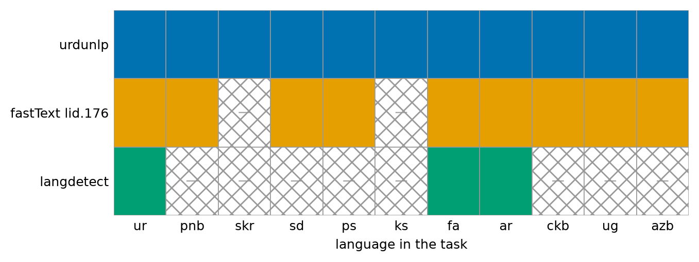
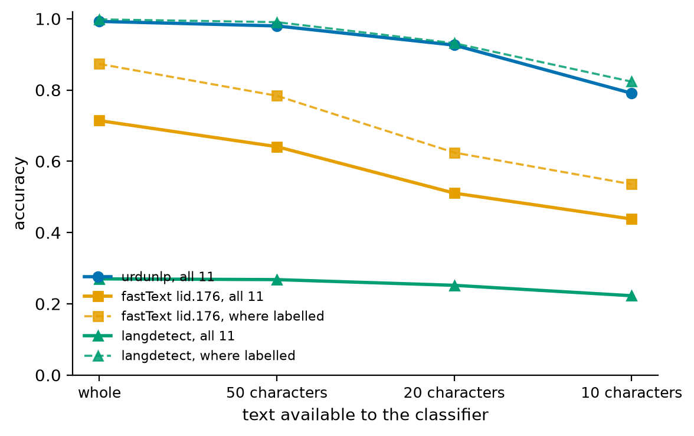
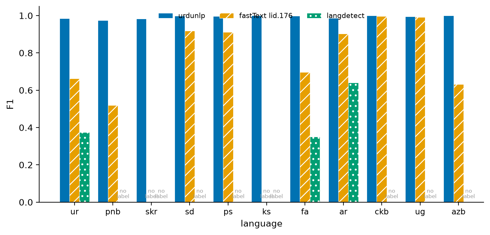
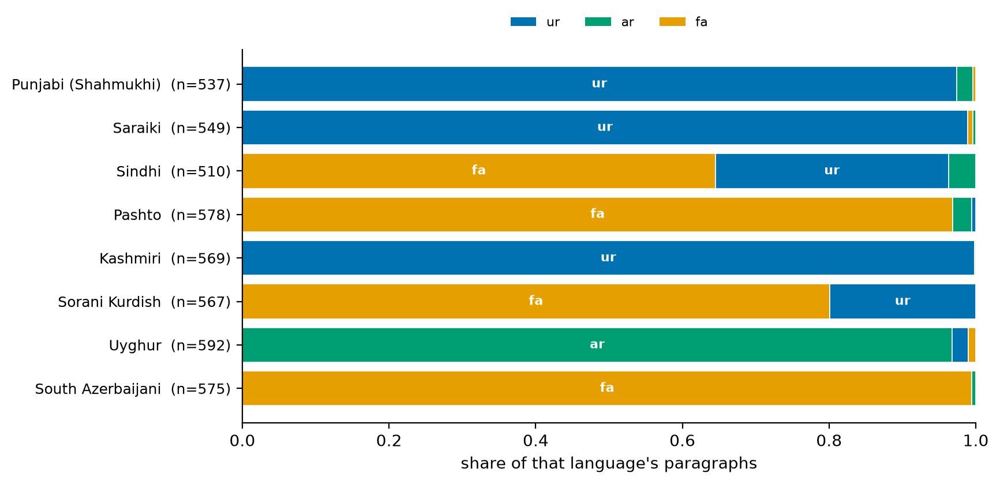
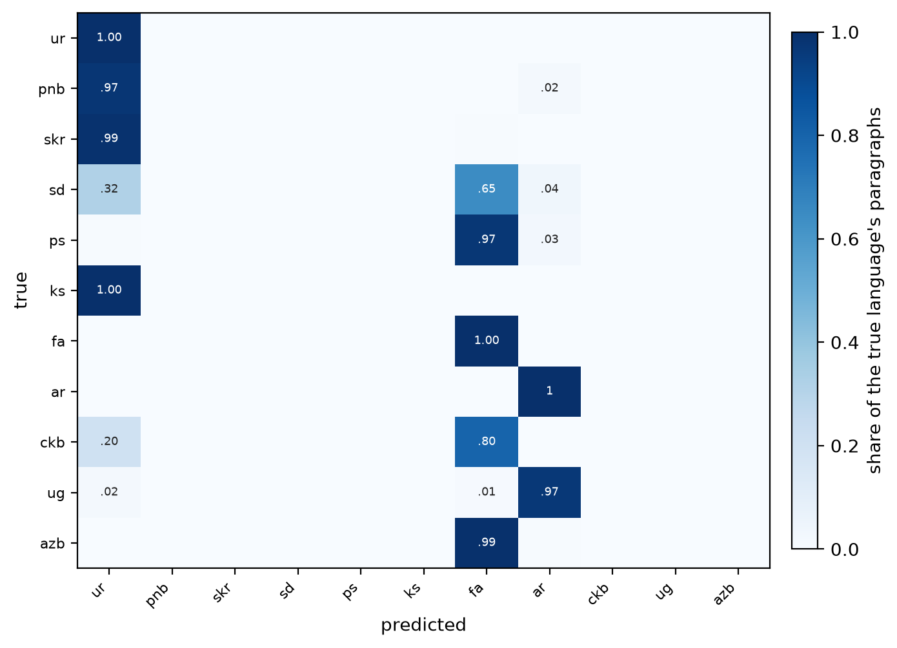
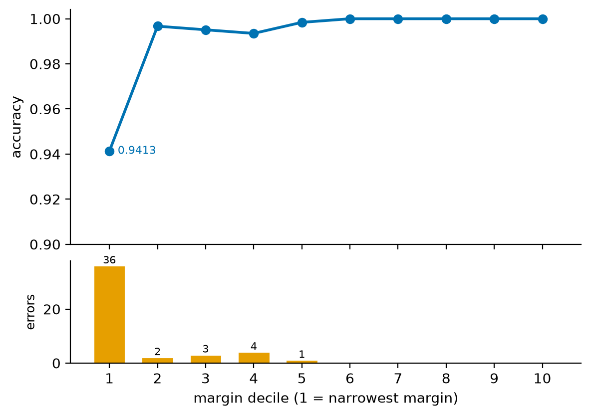
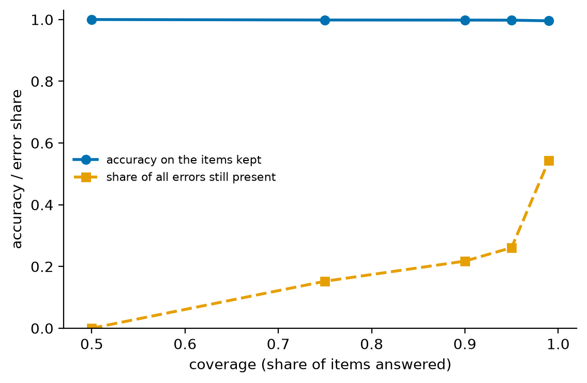

# Abstract

Language identification is treated as a solved problem, and for the languages that
benchmark it, it is. It is not solved for the Perso-Arabic script. Eleven languages share
it — Urdu, Shahmukhi Punjabi, Saraiki, Sindhi, Pashto, Kashmiri, Persian, Arabic, Sorani
Kurdish, Uyghur and South Azerbaijani — and the two detectors a project reaches for first
cannot name all of them: `langdetect` has a label for **3 of the 11**, fastText's
`lid.176` for **9**, missing Saraiki and Kashmiri, two of the three languages Urdu is most
confusable with. Coverage, not accuracy, is the first result: a detector with no label for
Saraiki cannot be right about Saraiki, and scoring it wrong says little.

Against a dedicated competitor — PALI [@pali], a fastText model trained for exactly this
script — a character n-gram classifier trained on Wikipedia reaches **0.9925** against
PALI's **0.8088** on 6,136 held-out paragraphs (McNemar, 1,136 vs 9 discordant,
p < 10⁻³²²).

That 0.9925 is the paper's second result, and it is a warning rather than an
achievement. On out-of-domain text the same model collapses: **0.5302** on Tatoeba Urdu
and **0.2565** on Quran-translation Urdu, with roughly three quarters of Urdu sentences
labelled Shahmukhi Punjabi. Two independent sources agree, so this is the model and not
label noise. No number available in the single-domain setup could have warned of it,
because training and test came from one domain.

Rebuilding the corpus from every real source these languages have — **3,587,017 lines
over 36 source–language pairs**, drawn from CC-100, eight OPUS corpora and two Wikimedia
projects, with every source contributing to train, validation and test — raises Urdu from
**0.5369 to 0.9459** and the overall figure from **0.8946 to 0.9728**, at a stated cost to
Shahmukhi Punjabi (0.9725 → 0.9317), which has no non-Wikimedia source to add. The contribution is therefore less a better classifier than
a demonstration that **single-domain evaluation of low-resource language ID is capable of
reporting 0.99 for a model that is wrong three times in four**, and a corpus and protocol
that make the failure visible.

# 1. Introduction

The Perso-Arabic script is shared by languages from three unrelated families. Urdu and
Shahmukhi Punjabi are mutually intelligible in writing to a degree that defeats
word-level heuristics; Saraiki is classified by some as a Punjabi dialect and writes with
four additional implosive letters that appear only sometimes; Kashmiri's Perso-Arabic
orthography competes with a Devanagari one, so even corpus collection has to check which
script a "Kashmiri" file is in.

General-purpose detectors address this by not addressing it. The gap is not that they are
inaccurate on these languages — it is that most of these languages are **not in their
label sets at all**, which is a different and more consequential problem, because a
missing label produces a confident wrong answer rather than an abstention.

A dedicated model exists. PALI [@pali] is a fastText classifier over nineteen
Perso-Arabic language labels, and it is the right comparator: it covers the task. This
paper measures against it and against the two general-purpose detectors, and then turns
the same instruments on its own result and finds it wanting.

**Prior work on the domain problem.** The general phenomenon in §5 is known and we do not
claim it. ConLID [@conlid] argues that cross-entropy-trained LID learns a domain's style
rather than a language's identity, which bites hardest for low-resource languages whose
training data comes from a single source, and reports gains out of domain from contrastive
training. DIVERS-Bench [@divers] evaluates LID across domains and finds systems — fastText
`lid.176` among them, itself largely Wikipedia-trained — failing to generalise out of
domain and in low-resource settings. An earlier draft of this paper claimed no such study
existed. It was wrong, as a comparable absence-based claim in a sibling project was also
wrong, and the two together are a reason to distrust the form of argument rather than
just to patch the sentence.

What is specific here is the instance and its mechanism: *which* languages collapse into
*which* others, measured on a script where the label sets of general-purpose detectors do
not even cover the task. The failure is not diffuse degradation but a single dominant
confusion — three quarters of out-of-domain Urdu labelled Shahmukhi Punjabi — and §6 shows
that rebuilding the corpus repairs it, at a cost that falls precisely on the two languages
with no second source to add. That cost is the part a general result cannot give, because
it is a property of what exists for these languages and not of the method.

# 2. Method

## 2.1 The task and the label set

Eleven languages, chosen because they are the ones Urdu is **actually** confused with
rather than a convenient set. All eleven are written in Perso-Arabic. Telling Urdu from
English is not the problem; telling it from Saraiki is.

The classifier is a character n-gram model over script-aware features. Its details are
not the contribution and are in the repository; what matters for this paper is that it is
small, has no neural component, and is the kind of model a project would actually depend
on.

## 2.2 Evaluation protocol

Every comparison scores all systems **on the same rows in the same run**. Rates carry
Wilson 95% intervals, which stay inside [0, 1] where the normal approximation does not —
and several rates here sit at the boundary. Paired comparisons use **McNemar's exact
test** over discordant pairs, computed in log space with `lgamma`, because the two-sided
tail underflows to 0.0 for tables as lopsided as 1,136 against 9 and a published
`p = 0` would be a floating-point artefact rather than a result.

Where a system has no label for a language, two numbers are reported: accuracy over all
eleven languages, and accuracy restricted to the classes the system can name. Only the
second is a statement about the model; only the first is a statement about using it for
this task.

A rate is **withheld** where the sample cannot support one. Tatoeba's Sindhi is seven
sentences; a rate over seven has an interval wider than the range it lives in, so the
count is published and the rate is not. The decision is on whether the population
supports the question, never on a row count alone, and the reason is printed in the
output rather than left to the reader.

# 3. Coverage comes first

| | labels in the model | labels for this task | no label for |
|---|---:|---:|---|
| **this tool** | 11 | **11 of 11** | — |
| PALI | 19 | **11 of 11** | — |
| fastText `lid.176` | 176 | 9 of 11 | **Saraiki, Kashmiri** |
| `langdetect` | 55 | **3 of 11** | Punjabi, Saraiki, Sindhi, Pashto, Kashmiri, Sorani, Uyghur, South Azerbaijani |

This table decides how to read every number below it. `langdetect` can name three of
eleven; fastText covers nine and still misses Saraiki and Kashmiri.

**Figure 1.** Label coverage of the eleven-language task by system.

# 4. Accuracy, whole and truncated

On the test split of the Wikipedia corpus — 6,136 paragraphs over eleven languages —
whole and cut to 50, 20 and 10 characters:

| | whole | 50 chars | 20 chars | 10 chars |
|---|---:|---:|---:|---:|
| **this tool** | **0.9925** | **0.9798** | **0.9260** | **0.7909** |
| PALI, principled mapping | 0.8088 | 0.7238 | 0.5758 | — |
| PALI, generous mapping | 0.8955 | 0.8020 | 0.6333 | — |
| fastText, all 11 languages | 0.7140 | 0.6410 | 0.5106 | 0.4379 |
| fastText, where it has a label | 0.8731 | 0.7838 | 0.6244 | 0.5355 |
| `langdetect`, all 11 languages | 0.2699 | 0.2678 | 0.2518 | 0.2226 |
| `langdetect`, where it has a label | 0.9982 | 0.9904 | 0.9313 | 0.8234 |

Two rows of that table need explaining, and both are concessions.

**PALI is scored under two label mappings.** PALI's label set is not this one: it has
`ud` where this task has `ur`, `pa` for Shahmukhi Punjabi, `kas` for Kashmiri, and
separate `mzn` (Mazanderani) and `sdh` (Southern Kurdish) labels. A mapping is therefore
required, and the choice of mapping is worth 8.7 points to PALI. An earlier draft learned
the mapping by majority vote on the validation split, which assigned `fa → mzn` and
`ckb → sdh` — that is, it credited PALI's *errors* as naming differences and scored them
correct. The principled mapping uses **identity wherever PALI has our code** and derives
a mapping only where it does not; the generous mapping is the majority-vote one, reported
beside it so the reader can see the size of the concession rather than take the author's
word for which is fair.

**`langdetect`, restricted to its three labels, is not beaten.** It scores 0.9982 against
this tool's 0.9964 on those 1,659 rows, and McNemar gives **p = 0.375** over five
discordant pairs. That is a null result and it is reported as one. On Urdu, Persian and
Arabic — three well-resourced languages with ample training data — a 2010-era detector is
as good as this one. The claim of this paper is about the eight languages `langdetect`
cannot name, not about the three it can.

**Figure 2.** Accuracy against input length. Every system degrades; the ordering does not
change.

## 4.1 Per-language F1

| language | support | this tool | PALI | fastText | `langdetect` |
|---|---:|---:|---:|---:|---:|
| ur | 578 | **0.985** | 0.718 | 0.662 | 0.374 |
| pnb | 537 | **0.975** | 0.797 | 0.519 | no label |
| skr | 549 | **0.983** | 0.936 | no label | no label |
| sd | 510 | **0.999** | 0.983 | 0.919 | no label |
| ps | 578 | **0.997** | 0.987 | 0.912 | no label |
| ks | 569 | **1.000** | 0.993 | no label | no label |
| fa | 523 | **0.999** | 0.475 | 0.696 | 0.351 |
| ar | 558 | **0.986** | 0.957 | 0.903 | 0.641 |
| ckb | 567 | **1.000** | 0.400 | 0.997 | no label |
| ug | 592 | **0.994** | 0.987 | 0.991 | no label |
| azb | 575 | **1.000** | 0.971 | 0.632 | no label |

Precision is reported as undefined, not as 0.0, where a system never predicts a class:
`langdetect` has no Punjabi label, so its Punjabi precision is a quantity with no
denominator and printing 0.000 would invent one.

PALI's two low cells — Persian 0.475 and Sorani 0.400 — are the mapping problem made
visible. Under the generous mapping they rise sharply, which is why both mappings are
published.

**Figure 3.** Per-class F1 across the four systems; absent labels left blank rather than
plotted as zero.

## 4.2 Paired significance

| comparison | this tool only | other only | discordant | p |
|---|---:|---:|---:|---|
| vs PALI | 1,136 | 9 | 1,145 | < 10⁻³²² |
| vs fastText | 1,717 | 8 | 1,725 | < 10⁻⁴⁹⁷ |
| vs `langdetect` | 4,438 | 4 | 4,442 | < 10⁻¹³²³ |
| vs `langdetect`, its 3 labels only | 1 | 4 | 5 | **0.375** |

The last row is the honest one and is why the first three are reported with their
restricted counterparts rather than alone.

## 4.3 A confound stated rather than discovered

**Possible train/test overlap with PALI, which we cannot rule out or confirm.** This test
set is Wikipedia. PALI's repository ships its training corpora but does not document
where they came from; neither the paper's abstract nor the repository names Wikipedia as
a source. An earlier draft of this paper asserted that PALI trains on Wikipedia dumps.
That assertion had no source and has been withdrawn — what can be said is that PALI's
provenance is undocumented, so overlap with these paragraphs is possible and unverified.

The direction matters more than the fact. Any overlap would run **in PALI's favour**, so
this tool's lead over PALI is conservative under it, and a lead for PALI could not have
been read as clean. Nothing in §4 depends on the overlap existing.

A second caveat on PALI's labels, from its own repository: it documents `sdh` as Southern
Kurdish while the distributed model's label list treats it inconsistently. The mapping in
§4 therefore uses identity wherever PALI has our code and reports the alternative beside
it, rather than resolving an ambiguity in another project's label set by assertion.

## 4.4 What a missing label actually does

A system with no label for a language does not abstain — it answers something else,
confidently. That is why coverage is §3 and not a footnote.

**Figure 4.** What `langdetect` answers for the eight languages it has no label for, whole
paragraphs. **Kashmiri is labelled Urdu in 99.8% of its paragraphs.** Each bar sums to
one; segments are the answers the system actually gave. For a pipeline routing text by
detected language, this is not a missing answer but a wrong one at near-certainty.

**Figure 5.** Row-normalised confusion for `langdetect` over 6,136 paragraphs. Every
answer fell inside the task's eleven labels, so the errors are misattributions among
these languages rather than escapes to unrelated ones.

## 4.5 Knowing when to doubt the answer

**Figure 6.** Accuracy by margin decile, 6,136 items, 613–614 per decile. **36 of the 46
errors (78%) fall in the narrowest decile**, so the margin carries usable information
about which answers to doubt. The accuracy axis is truncated below 0.9 to make the spread
visible; the error panel is not truncated. An earlier version of this figure used three
bins, which put 6,131 of the 6,136 items in one of them and showed nothing.

**Figure 7.** Selective prediction: answer only the items whose margin is in the top
fraction. At 50% coverage, accuracy on the 3,068 items kept is 1.0000 and **none of the 46
errors remain**. The error share is plotted beside accuracy because accuracy on a
shrinking set rises whether or not abstention is choosing the right items to drop.

This is the practical consequence of §3 and §4 together: a model that covers the task can
also say when it is unsure, and a model that cannot name the language cannot do either.
These numbers are in-domain, and §5 is about what happens when that assumption fails.

# 5. The result that matters: 0.9925 does not survive leaving Wikipedia

The number above was produced by training and testing on one domain. Two out-of-domain
sets, neither used in training:

| source | language | n | accuracy | dominant confusion |
|---|---|---:|---:|---|
| Tatoeba | ur | 2,812 | **0.5302** [0.5118, 0.5486] | pnb (1,255) |
| Tatoeba | pnb | 70 | 0.6857 [0.5697, 0.7824] | skr (15) |
| Tatoeba | skr | 133 | 0.9474 [0.8953, 0.9743] | pnb (4) |
| OPUS Tanzil | ur | 4,000 | **0.2565** [0.2432, 0.2703] | pnb (2,972) |
| OPUS Tanzil | ckb | 4,000 | 0.8682 | fa (516) |
| OPUS Tanzil | sd | 4,000 | 1.0000 | — |
| OPUS Tanzil | ar | 4,000 | 1.0000 | — |
| OPUS Tanzil | fa | 4,000 | 0.9998 | azb (1) |
| OPUS Tanzil | ug | 4,000 | 0.9998 | ar (1) |
| OPUS TED2020 | ps | 1,031 | 1.0000 | — |

Urdu falls from 0.9925 in domain to 0.5302 and 0.2565 out of it. **74.3% of Quran-
translation Urdu sentences are labelled Shahmukhi Punjabi.** Two unrelated corpora — a
crowd-sourced sentence bank and a religious translation — agree, which is what rules out
label noise in either one.

The languages that hold up are the ones whose Wikipedia is large and whose register is
broad. The ones that fall are the ones whose training text was narrow. That is a
statement about the corpus, not about the languages, and it is testable by changing the
corpus.

Two sources were **rejected** rather than used, and the rejections matter as much as the
inclusions: OPUS Tanzil `az` is 100% Latin script, so it is Azerbaijani and not South
Azerbaijani in Perso-Arabic; OPUS GNOME `ks` is 98% Devanagari, so it is Kashmiri in the
wrong orthography. A script-share check below 0.5 rejects a source outright. Without it,
both would have entered the corpus labelled as the languages they are not.

# 6. Rebuilding the corpus, and what it costs

The corpus was rebuilt from every real source that exists for these languages. CC-100's
120 languages, eighteen OPUS corpora and four Wikimedia projects were swept; what
actually yielded usable Perso-Arabic text was **CC-100, eight OPUS corpora and two
Wikimedia projects**, giving **36 source–language pairs and 3,587,017 lines**, with every
language above 100,000. The gap between what was swept and what yielded is itself the
resource picture: ten OPUS corpora and two Wikimedia projects have nothing for any of
these eleven languages.

Every source is split **80/10/10 within itself**, so the test split spans every domain
the training split saw. This is the design the single-domain setup lacked and the reason
it could not warn of §5.

Per-language counts, and the three kinds of row, are in `docs/CORPUS.md` §14; the
rejections — Latin-script `az`, Devanagari `ks` — are in §14.2, and Kashmiri's built rows
in §14.3.

Scored on identical rows, 74,592 test rows over 47 sources:

| language | n | Wikipedia-only | multi-source | change |
|---|---:|---:|---:|---:|
| **ur** | 13,003 | 0.5369 | **0.9459** | **+0.4090** |
| pnb | 1,200 | 0.9725 | 0.9317 | −0.0408 |
| skr | 1,200 | 0.9558 | 0.9500 | −0.0058 |
| sd | 6,001 | 0.9672 | 0.9795 | +0.0123 |
| ps | 7,515 | 0.9307 | 0.9707 | +0.0400 |
| ks | 1,322 | 0.9735 | 0.9977 | +0.0242 |
| fa | 17,089 | 0.9706 | 0.9693 | −0.0013 |
| ar | 18,214 | 0.9810 | 0.9856 | +0.0046 |
| ckb | 3,905 | 0.9729 | 0.9987 | +0.0258 |
| ug | 3,943 | 0.9914 | 0.9914 | +0.0000 |
| azb | 1,200 | 0.9908 | 0.9917 | +0.0009 |
| **overall** | **74,592** | **0.8946** | **0.9728** | **+0.0782** |

**The costs are real and are not rounded away.** Shahmukhi Punjabi loses 4.1 points and
Saraiki 0.6. Both are languages for which no non-Wikimedia Perso-Arabic source was found
across eighteen OPUS corpora, Tatoeba and CC-100's 120 languages. They therefore gained
no new domain while Urdu gained six, and the Urdu/Punjabi decision boundary moved towards
the language with more evidence behind it. That is a resource wall, not a modelling
choice, and no amount of tuning on this corpus removes it.

# 7. Threats to validity

**Wikimedia is not a domain, it is a family.** Punjabi, Saraiki, Kashmiri and South
Azerbaijani draw on Wikipedia and Wiktionary, which are different registers —
encyclopaedia prose against dictionary entries and inflection tables — but are written by
overlapping volunteer communities. Those four languages gained **size** here. The
domain-robustness question for them stays open, and the honest form of the §6 result is
that it is demonstrated for the languages that got new domains and assumed for the ones
that did not.

**Test labels are source labels.** A sentence in OPUS's `ur` file is Urdu because OPUS
says so. For the Urdu/Punjabi pair in particular, some fraction of any crawled corpus is
plausibly mislabelled, and the direction of that error is unknown.

**The out-of-domain sets are not a random sample of "out of domain".** Tatoeba is short
crowd-sourced sentences; Tanzil is a single religious register. Both are far from
Wikipedia, which is what made them useful, but neither represents deployment text.

**One model family.** Every number here is from one character n-gram architecture. The
collapse in §5 is a property of this model trained on that corpus; whether a transformer
trained on the same Wikipedia-only corpus would collapse the same way is untested and is
the obvious next experiment.

**Truncation is synthetic.** The 50-, 20- and 10-character rows cut whole paragraphs.
Real short text is not a truncated paragraph, and the degradation curve should be read as
an ordering of systems rather than as deployment accuracy.

# 8. Reproducibility

Every number rebuilds from the repository. `scripts/compare_langid.py` writes
`docs/langid-comparison.json` and `tests/test_langid_comparison.py` checks the published
comparison page against it, by table row and column rather than by substring presence —
an earlier guard asserted that a formatted value appeared *anywhere* in the document and
passed with two planted wrong numbers. `research/pali_baseline.py`,
`research/out_of_domain.py` and `research/out_of_domain_two.py` rebuild §4 and §5;
`research/build_corpus.py`, `research/make_splits.py` and
`research/evaluate_multisource.py` rebuild §6. Corpus construction is documented in
`docs/CORPUS.md` with the per-source line counts and every rejection and its reason.

Nothing in `research/` ships in the distributed package.

# References

- [@pali] Ahmadi, S., Agarwal, M. and Anastasopoulos, A. *PALI: A Language Identification Benchmark for Perso-Arabic Scripts.* VarDial @ EACL 2023; arXiv:2304.01322. Model and data: <https://github.com/sinaahmadi/PersoArabicLID> (MIT). 19 language labels; the distributed model is a quantised fastText classifier (`LID_model_merged.ftz`).
- [@fasttext-lid] Joulin, A. et al. *Bag of Tricks for Efficient Text Classification.* arXiv:1607.01759. Model `lid.176.ftz`.
- [@langdetect] Shuyo, N. *Language Detection Library for Java*, 2010; `langdetect` 1.0.9 is the Python port.
- [@cc100] Conneau, A. et al. *Unsupervised Cross-lingual Representation Learning at Scale.* arXiv:1911.02116. CC-100 corpus.
- [@opus] Tiedemann, J. *Parallel Data, Tools and Interfaces in OPUS.* LREC 2012.
- [@conlid] *ConLID: Supervised Contrastive Learning for Low-Resource Language Identification.* arXiv:2506.15304.
- [@divers] *DIVERS-Bench: Evaluating Language Identification Across Domains.* arXiv:2509.17768.
- Tatoeba sentence exports, CC-BY 2.0 FR. <https://downloads.tatoeba.org/>

> **Citation status.** PALI's bibliographic details, label set, architecture and licence
> were read from its arXiv page and its repository, because the comparison depends on
> them. Reading them corrected two things: the venue (VarDial @ EACL 2023, not arXiv
> alone) and, more importantly, §4.3 — an earlier draft asserted that PALI trains on
> Wikipedia, which neither the abstract nor the repository supports. Its paper's full
> text has not been read, and its reported accuracies are not quoted here.
>
> The remaining references are quoted from search summaries rather than from full texts
> and must each be read before submission.
>
> That confirmatory pass **was** done and it overturned the claim. An earlier draft said
> the search had found no prior study measuring in-domain against out-of-domain accuracy
> for language identification. ConLID [@conlid] and DIVERS-Bench [@divers] both do, and
> DIVERS-Bench tests the Wikipedia-trained fastText model directly. §1 now cites them and
> claims the instance rather than the phenomenon. Both are summarised from search results
> and abstracts, not read in full; their reported figures are not quoted here and should
> be checked before submission.
>
> This is the second absence-based novelty claim in this body of work to fail on a second
> search. Neither affected a measured result — both were claims about the literature, not
> about the data — but the pattern is recorded here rather than quietly fixed.
